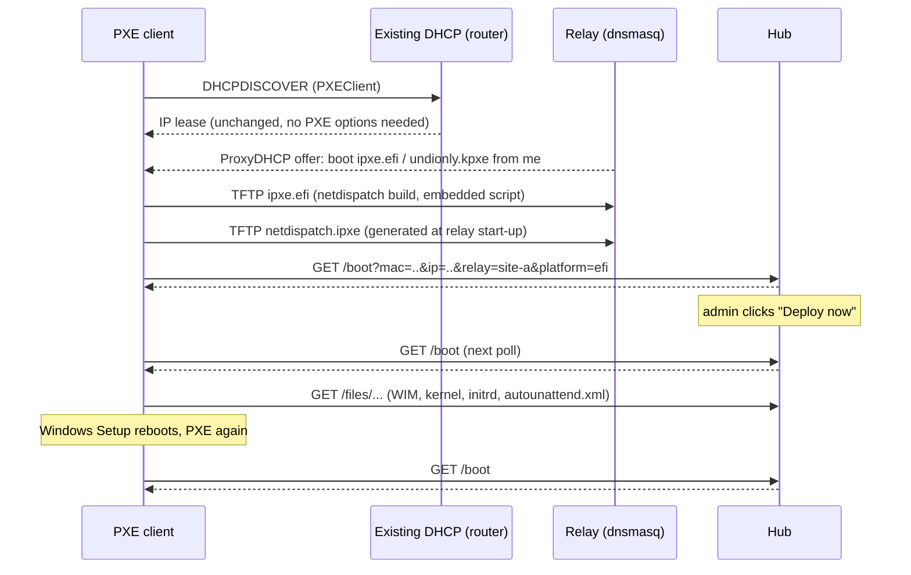

# netdispatch

**Self-hosted, Docker-native PXE boot coordination for many subnets and sites.**

netdispatch uses a hub-and-spoke design. A central **hub** holds the web dashboard, authentication, database and image repository. Small, stateless **relays** sit on each subnet or VLAN and answer PXE requests there. A machine that network-boots on any subnet with a relay shows up live on the dashboard, tagged with its site, and waits in a hold loop until an administrator dispatches something to it:

- a Windows install, with a per-machine `autounattend.xml`
- WinPE tools such as Hiren's BootCD PE
- a Linux live or installer ISO
- a raw diagnostic ISO

```
                       ┌──────────────────────────── hub (docker compose) ───────────────────────────┐
  admin browser ──────►│ reverse proxy ─► server :8000  FastAPI · SQLite · dashboard · OIDC · /boot   │
                       │                               /files/* (wimboot, kernels, WIMs, ISOs)       │
                       │                  samba  :445  read-only \\hub\netdispatch\<image-id>        │
                       └──────────────▲───────────────────────────────▲──────────────────────────────┘
                     heartbeat (30 s) │                               │ HTTP(S) boot traffic, SMB
             ┌────────────────────────┴───────┐       ┌───────────────┴────────────────┐
             │ relay "site-a-vlan20"          │       │ relay "branch-office"          │
             │ dnsmasq ProxyDHCP + TFTP       │  ...  │ dnsmasq ProxyDHCP + TFTP       │
             └───────▲────────────────────────┘       └───────▲────────────────────────┘
                     │ L2 broadcast (DHCP/PXE)                │
              PXE clients on VLAN 20                   PXE clients at the branch
```

## How a boot works



1. **ProxyDHCP.** The relay's dnsmasq runs in ProxyDHCP mode. It never hands out IP addresses. It only adds PXE boot information alongside your existing DHCP server's offer, so the router needs no changes.
2. **iPXE.** BIOS clients get `undionly.kpxe` and UEFI x64 clients get `ipxe.efi` (or `snponly.efi`), chosen by DHCP option 93. netdispatch compiles these binaries from source. Each one carries an **embedded script** that fetches `netdispatch.ipxe` from the relay instead of obeying the DHCP boot filename. So when the relay offers the binary again to a client already running netdispatch's iPXE, the client ignores it and can't loop.
   - By default (`IPXE_CLIENTS=chainload`), clients whose firmware or NIC ROM already runs some other iPXE build also get netdispatch's build. Proxmox and QEMU VMs are the common case. This gives every client the same HTTPS support and CA trust.
   - With `IPXE_CLIENTS=direct`, those clients are recognised by DHCP user class and fetch `netdispatch.ipxe` directly instead.
3. **Hold loop.** `netdispatch.ipxe` chains to `CENTRAL_SERVER_URL/boot`. An unknown MAC is recorded as **Waiting**, and the hub returns a banner (MAC, IP, relay, firmware) that sleeps and re-polls with `chain --replace`, so the loop never nests and can run for days.
4. **Dispatch.** On the next poll after an admin clicks **Deploy now**, the hub serves the payload script and marks the device **Booting payload**.
5. **One-shot.** The next time the device PXE-boots (for example, Windows Setup rebooting), the hub returns `exit`. The firmware falls through to the local disk. Alternatively, per deployment, the device goes back to the hold loop. A payload is never served twice by accident.

Device states: `Waiting` → `Deploying` (dispatched, not yet picked up) → `Booting payload` → `Local boot`. A device that stops polling for `DEVICE_OFFLINE_SECONDS` shows as `Offline`. **Reset to hold loop** and **Boot local** are always available.

## Quick start (hub)

Requirements: a Linux host with Docker Engine and Compose v2.24+.

```bash
git clone https://github.com/photoncody/netdispatch.git
cd netdispatch
cp .env.example .env
```

Edit `.env`. At minimum set these:

| Variable | Example | Why |
|---|---|---|
| `PUBLIC_URL` | `https://pxe.example.com` | UI address, OIDC redirect base |
| `BOOT_BASE_URL` | `http://10.0.0.5:8000` | Address PXE clients use (see below) |
| `SMB_PASSWORD` | long random string | Needed for Windows Setup deployments |
| `FALLBACK_ADMIN_PASSWORD` | long random string | Or leave empty to auto-generate |

```bash
docker compose up -d --build
docker compose logs server | grep -i password   # only if you left FALLBACK_ADMIN_PASSWORD empty
```

Open `PUBLIC_URL` (or `http://<host>:8000`) and sign in.

Data lives in `./data` (`DATA_PATH`):

| Path | Contents |
|---|---|
| `data/netdispatch.db` | SQLite: devices, relays, images, templates |
| `data/isos/` | uploaded or copied ISO files |
| `data/extracted/<id>/` | extracted image trees, served over HTTP and SMB |
| `data/configs/*.xml` | autounattend templates (editable on disk too) |

Extraction roughly doubles the disk space each ISO uses.

## Deploying relays

1. In the dashboard, open **Relays → Add relay**. Pick an ID (for example `site-office-vlan20`) and a name.
2. netdispatch shows a **one-time relay key** and a ready-made `docker-compose.yml`.
3. On a Linux host attached to the target subnet (a VM, NUC or Raspberry Pi is plenty), save the snippet and run:
   ```bash
   docker compose up -d --build
   ```
   You can also clone this repository and use `docker-compose.relay.yml` with the `RELAY_*` variables from `.env.example`.

The relay appears **online** within 30 seconds. Its card shows IP, subnet, interface and whether dnsmasq is running.

Relay requirements and notes:

- **Host networking is required** (`network_mode: host`, `cap_add: [NET_ADMIN]`). DHCP is a Layer 2 broadcast. Docker Desktop on Windows or macOS cannot receive it, so use a Linux host.
- **Nothing else on that host may listen on UDP 67 (DHCP) or 69 (TFTP).** Other hosts on the subnet can, and the router's DHCP server is expected to.
- **ProxyDHCP coexists with your router.** Your existing DHCP server keeps assigning addresses, and the relay only adds boot information. Make sure the existing DHCP server does **not** also hand out PXE options (66/67, "next-server", "boot file"), or clients may follow those instead.
- **One relay per broadcast domain.** For several VLANs, run one relay per VLAN. That can be one host with several VLAN interfaces, using one relay container per interface with `RELAY_INTERFACE` set.
- **Clients must reach the hub.** iPXE clients download everything (WIMs, kernels, ISOs) from `CENTRAL_SERVER_URL` directly, not through the relay. Windows Setup clients also need TCP 445 to the hub.
- `RELAY_INTERFACE` and `SUBNET_RANGE` are auto-detected from the default route. Override them on multi-homed hosts.
- `UEFI_BOOTFILE=snponly.efi` uses the firmware's own NIC driver. Try it if `ipxe.efi` has no driver for a NIC.
- `IPXE_CLIENTS=direct` lets clients that already run iPXE (NIC ROMs, VM firmware) skip netdispatch's iPXE build. That build is only needed for HTTPS or a private CA.
- **Bootstrap key.** If the hub has `RELAY_API_KEY` set, a relay presenting it auto-registers. This is convenient for labs. Per-relay keys from the UI can each be rotated or disabled individually.
- **Relay on the hub host.** To also serve the hub's own subnet, run `docker compose --profile local-relay up -d`.

## Images

Upload ISOs under **Images**, or copy them into `data/isos/` and click **Rescan**. Uploads are streamed straight to disk, so multi-GB files are fine.

Each image is then extracted with 7-Zip (UDF first, then ISO9660) and its boot profile is **auto-detected**:

| Detected layout | Boot method | What is served |
|---|---|---|
| `sources/boot.wim` + `sources/install.wim/esd` | `windows_setup` | wimboot + BCD + boot.sdi + boot.wim, plus injected `winpeshl.ini`, `netdispatch.cmd` and `autounattend.xml` |
| `sources/boot.wim` only (Hiren's, custom WinPE) | `winpe` | wimboot + BCD + boot.sdi + boot.wim |
| `casper/vmlinuz` (Ubuntu and derivatives) | `linux` | `boot=casper ip=dhcp url={iso_url} …` |
| `images/pxeboot/` (Fedora, RHEL, Rocky, Alma) | `linux` | `inst.repo={files_url}`, or `root=live:` for live images |
| `arch/boot/x86_64/` | `linux` | `archiso_http_srv={files_url}/` |
| `live/vmlinuz*` (Debian live) | `linux` | `boot=live fetch={files_url}/live/filesystem.squashfs` |
| `boot/vmlinuz-*` + `apks/` (Alpine) | `linux` | `alpine_repo=… modloop=…` |
| anything else | `sanboot` | the raw ISO over HTTP (range requests) |

Use **Edit profile** to change the boot method, WIM paths, kernel, initrds or command line. The field suggestions list the files in the extracted tree.

Kernel command-line placeholders:

| Placeholder | Meaning |
|---|---|
| `{iso_url}` | URL of the raw ISO |
| `{files_url}` | URL of the extracted tree (no trailing slash) |
| `{base_url}` | hub boot URL |
| `{mac}`, `{hostname}`, `{ip}`, `{relay}` | device values |

Notes:
- Ubuntu's `url=` mode downloads the whole ISO into RAM, so the client needs more RAM than the ISO size.
- `memdisk` is BIOS-only and suited to small images. On UEFI clients netdispatch falls back to `sanboot`.
- No single method boots *every* ISO over a network. Images that rely on finding their own CD-ROM after the kernel starts need a distro-specific command line.

## Windows deployments: wimboot, SMB and autounattend.xml

WinPE can be booted over HTTP, but Windows Setup then needs the full installation media (`install.wim`, several GB) as a file system. netdispatch serves it from the **samba sidecar**:

1. On dispatch, the hub generates a random **deployment token**. The payload script loads `wimboot` and injects these files into WinPE's `X:\Windows\System32`:
   - `BCD`, `boot.sdi` and `boot.wim` from the extracted ISO
   - from `/files/d/<token>/`:
     - `winpeshl.ini`, which replaces the WinPE shell with `netdispatch.cmd`
     - `netdispatch.cmd`, which runs `wpeinit`, maps `\\SMB_HOST\netdispatch\<image-id>` with `SMB_USERNAME`/`SMB_PASSWORD` (retrying until the network is up), then runs `setup.exe /unattend:X:\Windows\System32\autounattend.xml`
     - `autounattend.xml`, rendered for this MAC from the bound template
2. The samba share is read-only. It requires authentication and SMB2+ because Windows 11 24H2 WinPE rejects guest access, and it supports signing.
3. Token URLs only work while the deployment is in progress. The token is revoked as soon as the device returns to PXE, is reset, or is set to local boot. The unattend file and SMB credentials are never reachable through a guessable URL.

**Unattend templates** (**Unattend** tab, stored in `data/configs/`) are Jinja2 templates, rendered in a sandbox with XML escaping. Available variables:

| Variable | Value |
|---|---|
| `{{ hostname }}` | device label, or `ND-<last 6 MAC digits>`, truncated to 15 characters for `<ComputerName>` |
| `{{ mac }}` | e.g. `aa:bb:cc:dd:ee:ff` |
| `{{ mac_dash }}` | e.g. `AA-BB-…` |
| `{{ mac_plain }}` | e.g. `AABB…` |
| `{{ ip }}` | client IP |
| `{{ relay }}` | relay ID |
| `{{ image }}` | dispatched image name |

Templates are validated on save: they must render to well-formed XML.

Firewall: clients that install Windows need TCP 445 to the hub, besides HTTP(S). Set `SMB_HOST` if WinPE should reach Samba at a different address than `BOOT_BASE_URL`'s host.

Hiren's BootCD PE and other WinPE-only images use the `winpe` method: wimboot only, with no SMB and no Setup.

## Running behind a reverse proxy

The hub speaks plain HTTP on port 8000. Put it behind your existing reverse proxy for the UI:

- Set `PUBLIC_URL` to the external `https://` URL. OIDC redirect URIs are built from it, and cookies become `Secure` when it is HTTPS.
- Set `FORWARDED_ALLOW_IPS` to the proxy's address so that uvicorn trusts `X-Forwarded-For` and `X-Forwarded-Proto`. netdispatch never builds URLs from the `Host` or `X-Forwarded-Host` headers. Every absolute URL comes from `PUBLIC_URL` or `BOOT_BASE_URL`.
- Disable request body size limits on the proxy for `/api/isos/upload` (ISOs are several GB). Also raise its timeouts.

**Boot traffic and TLS.** iPXE verifies HTTPS certificates against public CAs by default. If the proxy uses a private CA, choose one of these:

- Set `BOOT_BASE_URL` (and the relays' `CENTRAL_SERVER_URL`) to a plain-HTTP LAN address such as `http://10.0.0.5:8000`. This is also faster for multi-GB WIM transfers.
- Put your CA certificate in `relay/certs/` before building the relay, so it is compiled into iPXE. See [relay/certs/README.md](relay/certs/README.md).

Exposure: `/boot`, `/files/*` and `/api/relays/heartbeat` must be reachable by clients and relays. Everything else needs a session.

<details>
<summary>nginx</summary>

```nginx
server {
    listen 443 ssl http2;
    server_name pxe.example.com;
    # ssl_certificate ...;

    client_max_body_size 0;          # ISO uploads
    proxy_request_buffering off;     # stream uploads straight through
    proxy_read_timeout 3600s;
    proxy_send_timeout 3600s;

    location / {
        proxy_pass http://10.0.0.5:8000;
        proxy_set_header Host $host;
        proxy_set_header X-Forwarded-For $proxy_add_x_forwarded_for;
        proxy_set_header X-Forwarded-Proto $scheme;
        proxy_set_header X-Forwarded-Host $host;
    }
}
```
</details>

<details>
<summary>Caddy</summary>

```caddy
pxe.example.com {
    request_body {
        max_size 20GB
    }
    reverse_proxy 10.0.0.5:8000
}
```
</details>

<details>
<summary>Traefik (labels on the server service)</summary>

```yaml
labels:
  - traefik.enable=true
  - traefik.http.routers.netdispatch.rule=Host(`pxe.example.com`)
  - traefik.http.routers.netdispatch.tls=true
  - traefik.http.services.netdispatch.loadbalancer.server.port=8000
```
Traefik streams request bodies by default. Add `FORWARDED_ALLOW_IPS=<traefik network CIDR>` to `.env`.
</details>

## Authentication

**OIDC / SSO** uses Authlib with any standards-compliant provider (Authentik, Keycloak, Entra ID, Okta, Google Workspace, Zitadel and others):

```env
OIDC_ENABLED=true
OIDC_CLIENT_ID=netdispatch
OIDC_CLIENT_SECRET=...
OIDC_METADATA_URL=https://auth.example.com/application/o/netdispatch/.well-known/openid-configuration
OIDC_SCOPES=openid email profile
OIDC_ALLOWED_GROUPS=pxe-admins        # optional
AUTO_REDIRECT_SSO=true                # optional: skip the login page
```

- Register the redirect URI `PUBLIC_URL/auth/oidc/callback` with the provider. PKCE (S256) is used.
- Example metadata URLs:
  - Keycloak: `https://kc.example.com/realms/<realm>/.well-known/openid-configuration`
  - Entra ID: `https://login.microsoftonline.com/<tenant>/v2.0/.well-known/openid-configuration` (for group filtering, set `OIDC_GROUPS_CLAIM=groups` and emit group IDs)
- With `AUTO_REDIRECT_SSO=true`, unauthenticated browser requests go straight to the provider. API requests get `401` instead.

**Emergency local admin.** `FALLBACK_ADMIN_USERNAME`/`FALLBACK_ADMIN_PASSWORD` log in at **`/login?local=true`**, which never auto-redirects. This keeps the console reachable when the IdP is down. If SSO can't be reached, the login page falls back to the local form automatically. Failed attempts are rate-limited per IP. Set `FALLBACK_ADMIN_ENABLED=false` to turn the local login off.

**Session exemptions.** These paths are never redirected to SSO:
- `/health`
- `/boot`
- `/files/*` (booting PCs)
- `/api/relays/heartbeat` (authenticated by the `X-Relay-Key` header)

Relay *management* (`/api/relays` create, rotate, delete) requires an admin session.

## Configuration reference

Every setting is an environment variable. [.env.example](.env.example) documents them all, grouped into hub URLs, sessions, OIDC, local admin, relays, boot behaviour, SMB, and relay settings.

## Security notes

- `/boot` is unauthenticated by design, because PXE clients cannot authenticate. Anyone on a relay subnet can make a MAC address appear. Set `NEW_DEVICE_STATE=local` if unknown machines should boot normally until an admin stages them. To stage a machine, pre-register its MAC or reset it to the hold loop.
- `/files/iso/*` serves image contents without authentication. Don't upload images that contain secrets. Secrets belong in unattend templates, which are only reachable through per-deployment tokens.
- Relay keys are stored as SHA-256 hashes. A key is shown once at creation or rotation.
- Mutating API calls require the `X-Requested-With: netdispatch` header, and session cookies are `SameSite=Lax`, which together block CSRF.
- The SMB share is read-only.

## Development

```bash
# Unit/integration tests (in Docker, no local Python needed)
docker build --target test -t netdispatch-test server/ && docker run --rm netdispatch-test

# Local run without Docker (static CSS is built in the Dockerfile; UI will be unstyled)
cd server && pip install -r requirements-dev.txt
DATA_DIR=./data-dev FALLBACK_ADMIN_PASSWORD=dev uvicorn app.main:create_app --factory --reload
```

Layout:

| Path | Contents |
|---|---|
| `server/app/main.py` | app factory, middleware wiring |
| `server/app/auth.py` | OIDC, auto-SSO session guard, local admin |
| `server/app/pxe_engine.py` | iPXE script generation |
| `server/app/routers/boot.py` | `/boot` state machine |
| `server/app/iso_tools.py` | extraction, detection, safe path resolution |
| `server/app/winpe.py` | WinPE launch script |
| `server/app/unattend.py` | template storage and rendering |
| `server/app/templates/` | dashboard (Tailwind + Alpine.js, compiled at image build, no CDN at runtime) |
| `relay/` | dnsmasq entrypoint, heartbeat, iPXE build (pinned `v2.0.0`, embedded script) |
| `samba/` | SMB sidecar |

## Limitations (v1)

- x86 clients only (BIOS and UEFI x64). There are no ARM64 UEFI iPXE builds yet.
- Relays don't cache payloads. Remote sites download images from the hub over the WAN.
- There is no progress reporting from inside WinPE or Setup. The dashboard shows when the payload was served and when the device came back.
- There is a single admin role.

## License

MIT. See [LICENSE](LICENSE).
