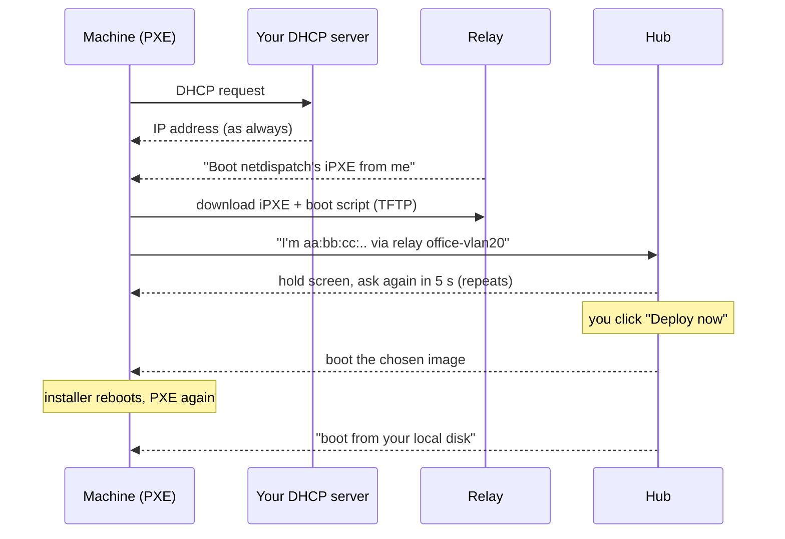

# netdispatch

**Self-hosted network boot (PXE) coordination for many subnets and sites.**

Plug a machine in, set it to boot from the network, and it appears on the netdispatch dashboard. It waits there until you pick what it should boot:

- a Windows 11/10 install that runs fully unattended, from an `autounattend.xml` template rendered for that machine
- a WinPE toolkit such as Hiren's BootCD PE
- a Linux live system or installer
- any other bootable ISO

netdispatch has two parts:

- **Hub.** One central server holds the web dashboard, sign-in, the database and your image library.
- **Relays.** A tiny container runs on each network segment where machines will PXE-boot. Relays work *alongside* your existing DHCP server, so routers and firewalls need no PXE configuration.

```
                       ┌──────────────────────────── hub (docker compose) ───────────────────────────┐
  admin browser ──────►│ reverse proxy ─► server :8000   dashboard · sign-in · boot scripts · images │
                       │                  samba  :445    read-only Windows install share             │
                       └──────────────▲───────────────────────────────▲──────────────────────────────┘
                     heartbeat (30 s) │                               │ boot downloads (HTTP/S, SMB)
             ┌────────────────────────┴───────┐       ┌───────────────┴────────────────┐
             │ relay "office-vlan20"          │       │ relay "branch-office"          │
             └───────▲────────────────────────┘  ...  └───────▲────────────────────────┘
                     │ PXE broadcasts                         │
              machines on VLAN 20                     machines at the branch
```

---

## Contents

1. [How it works](#how-it-works)
2. [Requirements](#requirements)
3. [Install the hub](#install-the-hub)
4. [Put the hub behind a reverse proxy](#put-the-hub-behind-a-reverse-proxy)
5. [Sign-in: SSO and the local admin](#sign-in-sso-and-the-local-admin)
6. [Add relays](#add-relays)
7. [Add images](#add-images)
8. [Windows installs and unattend templates](#windows-installs-and-unattend-templates)
9. [Deploy a machine](#deploy-a-machine)
10. [Operations: upgrades, backups, logs](#operations-upgrades-backups-logs)
11. [Troubleshooting](#troubleshooting)
12. [Configuration reference](#configuration-reference)
13. [Security notes](#security-notes)
14. [Limitations](#limitations)

---

## How it works



Each machine moves through these states on the dashboard:

| Status | Meaning |
|---|---|
| **Waiting** | The machine is on the hold screen, checking in every 5 seconds. |
| **Deploying** | You dispatched an image. It is served on the machine's next check-in. |
| **Booting payload** | The image was handed to the machine and is booting or installing. |
| **Local boot** | The next time it network-boots, netdispatch tells it to boot from its own disk. |
| **Offline** | A waiting machine stopped checking in (turned off or unplugged). |

A dispatch is **one-shot**. When an installer reboots the machine and it network-boots again, it is sent to its local disk instead of reinstalling. You can choose "return to the hold loop" instead, per dispatch.

## Requirements

**Hub host**
- A Linux server or VM with Docker Engine and Docker Compose v2.24 or newer (`docker compose version`). Building also needs buildx 0.17 or newer (`docker buildx version`).
- Disk space for your images. Every ISO is kept *and* extracted, so plan for about twice its size. A Windows ISO needs about 16 GB.

**Relay hosts** (one per network segment)
- Any small Linux machine or VM attached to that segment: a NUC, a Raspberry Pi or a VM on that VLAN.
- It must be **Linux with Docker Engine**. Docker Desktop on Windows or macOS cannot receive DHCP broadcasts.
- Nothing else on that host may use UDP ports 67 (DHCP) or 69 (TFTP).

**Network**

| From | To | Port | Why |
|---|---|---|---|
| Machines being booted | relay on their segment | UDP 67, 68, 4011, 69 | PXE + TFTP (broadcast, same segment) |
| Machines being booted | hub | TCP 8000 (or your proxy's 80/443) | boot scripts, kernels, images |
| Machines installing Windows | hub | TCP 445 | Windows install share (SMB) |
| Relays | hub | TCP 8000 / 443 | heartbeat |
| Admins | hub | TCP 443 / 8000 | dashboard |

Your existing DHCP server must **not** hand out PXE boot options of its own (option 66/67, "next-server", "boot file name"). Remove them if they are set.

## Install the hub

1. **Get the code and create your settings file.**
   ```bash
   git clone https://github.com/photoncody/netdispatch.git
   cd netdispatch
   cp .env.example .env
   ```

2. **Edit `.env`.** These are the settings almost everyone changes:

   | Setting | Example | What it's for |
   |---|---|---|
   | `PUBLIC_URL` | `https://pxe.example.com` | The address you open the dashboard at |
   | `BOOT_BASE_URL` | `http://10.0.0.5:8000` | The address *booting machines* use to reach the hub. See [below](#which-boot-url). |
   | `SMB_PASSWORD` | a long random string | Required for Windows installs. No double quotes. |
   | `FALLBACK_ADMIN_PASSWORD` | a long random string | Local admin password. Leave empty to have one generated. |

3. **Start it.**
   ```bash
   docker compose up -d --build
   ```
   The first build takes a few minutes.

4. **Sign in.** Open `PUBLIC_URL` (or `http://<hub-ip>:8000`) and sign in as `admin`. If you left `FALLBACK_ADMIN_PASSWORD` empty, read the generated password from the log:
   ```bash
   docker compose logs server | grep -i "admin password"
   ```
   The password is also saved in `data/initial_admin_password`.

Everything netdispatch stores lives in `./data` (change it with `DATA_PATH`):

| Path | Contents |
|---|---|
| `data/netdispatch.db` | devices, relays, images, templates |
| `data/isos/` | your ISO files |
| `data/extracted/<id>/` | extracted copies of each ISO |
| `data/configs/` | unattend templates (plain XML files, editable on disk) |
| `data/secret_key` | session signing key |

### Which boot URL?

Booting machines run iPXE, which downloads everything from `BOOT_BASE_URL`. It defaults to `PUBLIC_URL`.

- **Simplest and fastest:** use the hub's plain-HTTP LAN address, for example `BOOT_BASE_URL=http://10.0.0.5:8000`. Multi-gigabyte Windows images transfer faster without TLS.
- **HTTPS with a public certificate** (for example Let's Encrypt): `PUBLIC_URL` works as is.
- **HTTPS with a private/internal CA:** iPXE won't trust it by default. Either use a plain-HTTP boot URL, or put your CA certificate in `relay/certs/` before building the relays. See [relay/certs/README.md](relay/certs/README.md).

Relays use the same address as their `CENTRAL_SERVER_URL`. Generated relay snippets fill it in for you.

## Put the hub behind a reverse proxy

You can run the dashboard behind your existing reverse proxy:

- Set `PUBLIC_URL` to the external `https://` address.
- Set `FORWARDED_ALLOW_IPS` to your proxy's IP address (or the CIDR of its Docker network) so client IPs and HTTPS are detected correctly.
- **Allow large uploads.** Remove the proxy's request-size limit and raise its timeouts. ISOs are several GB.
- Booting machines may keep using the hub's direct LAN address (`BOOT_BASE_URL`). They don't need to go through the proxy.

<details>
<summary>nginx</summary>

```nginx
server {
    listen 443 ssl http2;
    server_name pxe.example.com;
    # ssl_certificate / ssl_certificate_key ...

    client_max_body_size 0;          # ISO uploads
    proxy_request_buffering off;     # stream uploads straight through
    proxy_read_timeout 3600s;
    proxy_send_timeout 3600s;

    location / {
        proxy_pass http://10.0.0.5:8000;
        proxy_set_header Host $host;
        proxy_set_header X-Forwarded-For $proxy_add_x_forwarded_for;
        proxy_set_header X-Forwarded-Proto $scheme;
    }
}
```
</details>

<details>
<summary>Caddy</summary>

```caddy
pxe.example.com {
    request_body {
        max_size 20GB
    }
    reverse_proxy 10.0.0.5:8000
}
```
</details>

<details>
<summary>Traefik (labels on the server service)</summary>

```yaml
labels:
  - traefik.enable=true
  - traefik.http.routers.netdispatch.rule=Host(`pxe.example.com`)
  - traefik.http.routers.netdispatch.tls=true
  - traefik.http.services.netdispatch.loadbalancer.server.port=8000
```
Also set `FORWARDED_ALLOW_IPS` to the CIDR of Traefik's Docker network.
</details>

## Sign-in: SSO and the local admin

### Single sign-on (OIDC)

Works with any OpenID Connect provider: Authentik, Keycloak, Microsoft Entra ID, Okta, Google Workspace, Zitadel and others.

1. In your identity provider, create an OIDC application:
   - type: confidential, authorization-code flow
   - redirect URI: `https://pxe.example.com/auth/oidc/callback`, which is your `PUBLIC_URL` + `/auth/oidc/callback`
2. Add the values to `.env`:
   ```env
   OIDC_ENABLED=true
   OIDC_CLIENT_ID=netdispatch
   OIDC_CLIENT_SECRET=...
   OIDC_METADATA_URL=https://auth.example.com/application/o/netdispatch/.well-known/openid-configuration
   OIDC_PROVIDER_NAME=Authentik            # label on the sign-in button
   OIDC_ALLOWED_GROUPS=pxe-admins          # optional: restrict to these groups
   AUTO_REDIRECT_SSO=true                  # optional: skip the sign-in page entirely
   ```
3. Apply it: `docker compose up -d`.

Example metadata URLs:

| Provider | `OIDC_METADATA_URL` |
|---|---|
| Keycloak | `https://kc.example.com/realms/<realm>/.well-known/openid-configuration` |
| Entra ID | `https://login.microsoftonline.com/<tenant-id>/v2.0/.well-known/openid-configuration` |

For group filtering with Entra ID, emit the `groups` claim and list group **IDs** in `OIDC_ALLOWED_GROUPS`.

### Local admin (emergency access)

The local `admin` account (`FALLBACK_ADMIN_USERNAME` / `FALLBACK_ADMIN_PASSWORD`) keeps working even when SSO is configured:

- Go to **`/login?local=true`**. This page never redirects to SSO.
- If the identity provider is unreachable, netdispatch shows the local sign-in form automatically.
- Repeated wrong passwords from one address are temporarily blocked.
- To disable the local account, set `FALLBACK_ADMIN_ENABLED=false`.

## Add relays

1. In the dashboard, open **Relays → Add relay**.
2. Enter an ID (lowercase, for example `office-vlan20`) and a display name, then click **Create relay**.
3. Copy the **relay key**. It is shown only once.
4. Copy the generated **docker-compose.yml**.
5. On a Linux host attached to that network segment, save the file and start the relay:
   ```bash
   docker compose up -d --build
   ```

Within 30 seconds the relay's card turns **online** and shows its IP, subnet and interface.

The generated file builds the relay straight from GitHub by default. To use a prebuilt image instead, set `RELAY_IMAGE` on the hub. That avoids compiling iPXE on every relay host, which matters on a Raspberry Pi. Prebuilt images for amd64 and arm64 are published at `ghcr.io/photoncody/netdispatch-relay:latest` (and `-server`, `-samba`). Pull requests also publish `:pr-<number>` builds for testing. Alternatively, build from a local checkout with `docker-compose.relay.yml` and the `RELAY_*` settings from `.env.example`.

Relay options (environment variables in the compose file):

| Setting | Default | Use it when |
|---|---|---|
| `RELAY_INTERFACE` | interface of the default route | the host has several network interfaces |
| `SUBNET_RANGE` | detected from the interface | you want to state the subnet explicitly, e.g. `192.168.20.0,proxy` |
| `UEFI_BOOTFILE` | `ipxe.efi` | a UEFI machine's network card isn't detected. Try `snponly.efi`, which uses the firmware's own driver. |
| `IPXE_CLIENTS` | `chainload` | `direct` skips loading netdispatch's iPXE on machines that already run iPXE, such as some VMs. Only works without HTTPS or a private CA. |
| `RELAY_LOG_DHCP` | `true` | set to `false` to quiet the logs once everything works |

**Several VLANs on one host:** run one relay container per VLAN interface. Give each its own `RELAY_ID`, key and `RELAY_INTERFACE`.

**A relay on the hub host itself:** add `LOCAL_RELAY_API_KEY` (or a bootstrap `RELAY_API_KEY`) to `.env`, then run:
```bash
docker compose --profile local-relay up -d
```

**Per-relay keys:**
- **Rotate key** issues a new key; the old one stops working immediately.
- **Disable** blocks a relay without deleting it.
- A bootstrap `RELAY_API_KEY` on the hub lets relays register themselves on first contact. It's convenient in a lab, but per-relay keys are safer.

## Add images

Open **Images** and click **Upload ISO**. The upload shows a progress bar. For very large files, you can instead copy them into `data/isos/` on the hub and click **Rescan /data/isos**.

Each image is then extracted, and netdispatch works out how to boot it:

| Detected | Boot method | Notes |
|---|---|---|
| Windows 10/11 or Server install media | `windows_setup` | full unattended install, see the next section |
| WinPE-based tools (Hiren's BootCD PE, custom PE) | `winpe` | boots the PE environment, no installer |
| Ubuntu and derivatives (casper) | `linux` | the client needs more RAM than the ISO size, because the ISO is loaded into memory |
| Fedora, RHEL, Rocky, Alma | `linux` | installer or live image |
| Arch Linux | `linux` | |
| Debian live | `linux` | |
| Alpine | `linux` | |
| anything else | `sanboot` | boots the raw ISO. Works for many UEFI tools and small rescue images. |

Use **Edit profile** to adjust how an image boots:

- **Method:** `windows_setup`, `winpe`, `linux`, `sanboot`, or `memdisk` (BIOS only; for small images).
- **Linux:** kernel, initrd(s) and kernel command line. The fields suggest file names from the image. The command line can use these placeholders:

  | Placeholder | Becomes |
  |---|---|
  | `{iso_url}` | download address of the raw ISO |
  | `{files_url}` | address of the extracted files |
  | `{base_url}` | the hub's boot URL |
  | `{mac}`, `{hostname}`, `{ip}`, `{relay}` | values of the machine being booted |

  Example: add `console=ttyS0,115200` to see a Linux boot on a serial console.
- **Windows/WinPE:** paths to `BCD`, `boot.sdi` and `boot.wim`, and the Setup program.
- **Re-run auto-detection** resets a profile. **Re-extract ISO** rebuilds the extracted copy.

Not every ISO can boot over a network. Distributions that look for their own CD after the kernel starts need a distribution-specific command line, and the detected profiles provide one for the families listed above.

## Windows installs and unattend templates

How a Windows install runs:

1. The machine boots Windows PE from the hub over HTTP.
2. WinPE connects to the hub's read-only install share: `\\<hub>\netdispatch\<image-id>`.
3. Windows Setup runs from that share, using the machine's `autounattend.xml` if you selected one.
4. When Setup reboots, the machine is sent to its local disk and the install continues there.

**Prerequisites:**
- `SMB_PASSWORD` is set in `.env`.
- Machines can reach the hub on TCP 445. If they must use a different address than the boot URL's host, set `SMB_HOST`.

### Unattend templates

Manage templates under **Unattend**. You can create one from scratch, import an existing `autounattend.xml` with **Import .xml**, or drop XML files into `data/configs/`.

A ready-made template is included: [examples/unattend/win11-uefi-basic.xml](examples/unattend/win11-uefi-basic.xml). It has been tested end to end and does the following:
- erases disk 0 and installs Windows
- skips the TPM, Secure Boot and RAM checks
- creates a local administrator, `ndadmin`
- skips the out-of-box screens
- signs in once automatically

**Change its password before you use it.**

Templates can contain per-machine values, filled in when each machine downloads its file:

| Write this in the template | Becomes |
|---|---|
| `{{ hostname }}` | the machine's label from the dashboard, or `ND-` + the last 6 digits of its MAC. Shortened to 15 characters, the Windows computer-name limit. |
| `{{ mac }}` | `aa:bb:cc:dd:ee:ff` |
| `{{ mac_dash }}` | `AA-BB-CC-DD-EE-FF` |
| `{{ mac_plain }}` | `AABBCCDDEEFF` |
| `{{ ip }}` | the machine's IP address |
| `{{ relay }}` | the relay ID the machine booted through |
| `{{ image }}` | the image name |

Templates are checked when you save them: the result must be valid XML. Use **Preview rendered** to see the final file.

### Drivers in WinPE

Windows PE only includes standard drivers.

- **Physical machines:** most Intel and Realtek network cards, NVMe and SATA (AHCI) disks work out of the box.
- **Intel VMD/RST storage (many recent laptops):** Setup won't see the disk. Switch the firmware's storage mode to AHCI, or add the RST driver to the image's `boot.wim`.
- **Virtual machines:** use an **e1000e** network card and an NVMe or SATA disk. With VirtIO devices, WinPE can't reach the share and Setup won't find the disk, unless you add the VirtIO drivers to `boot.wim`.

## Deploy a machine

1. **Boot the machine from the network.** Choose network/PXE boot once, or put it first in the boot order. It shows a hold screen with its MAC address, IP and site, and appears under **Devices** as **Waiting**.
2. Click **Dispatch / Configure** on its row.
3. Fill in the dialog:
   - **Label / hostname:** optional. Used as the Windows computer name via `{{ hostname }}`.
   - **Image:** what to boot.
   - **autounattend.xml template:** shown for Windows install images. Choose none for an interactive Setup.
   - **After the payload boots:**
     - **boot from local disk** (recommended for installs)
     - **return to the hold loop** (for tools you want to run again)
4. Click **Deploy now**. Within a few seconds the machine leaves the hold screen and boots the image.

Other actions in the same dialog:

| Button | Effect |
|---|---|
| **Reset to hold loop** | Cancels a pending dispatch, or brings a machine back to the hold screen on its next network boot. |
| **Boot local** | The machine boots its own disk whenever it network-boots. |
| **Forget device** | Removes it from the list. It reappears if it network-boots again. |
| **Preview the iPXE script** | Shows exactly what the machine will receive next. Useful for troubleshooting. |

**Tips**
- **Prepare in advance:** **Pre-register MAC** adds a machine before it ever boots, so you can dispatch to it ahead of time.
- **Let unknown machines boot normally:** by default every unknown machine that network-boots waits on the hold screen. Set `NEW_DEVICE_STATE=local` so they boot their own disk until you stage them.
- **Network boot first works well:** with network boot first in the boot order, machines boot their own disk every time unless you dispatch something.

## Operations: upgrades, backups, logs

**Upgrade the hub**
```bash
git pull
docker compose up -d --build
```
Upgrade relays the same way on each relay host (`docker compose up -d --build`).

**Back up** `data/netdispatch.db`, `data/configs/` and `data/secret_key`. ISOs can be re-downloaded, and the extracted copies are rebuilt with **Re-extract**. For a consistent database copy, stop the server first (`docker compose stop server`) or use `sqlite3 data/netdispatch.db ".backup backup.db"`.

**Logs**
```bash
docker compose logs -f server            # hub: boot requests, downloads, sign-ins
docker compose logs -f samba             # Windows share access
docker logs -f netdispatch-relay         # on a relay host: every DHCP/TFTP exchange
```

## Troubleshooting

| Symptom | Likely cause and fix |
|---|---|
| Machine gets an IP but reports *no boot file* / *PXE-E53*, or the relay log shows nothing | The relay isn't on the same segment, is listening on the wrong interface (`RELAY_INTERFACE`), or a firewall on the relay host blocks UDP 67/4011/69. Check that the relay card says dnsmasq **running**. |
| Hold screen never appears; iPXE says *no ProxyDHCP relay answered* | Same as above. Also make sure the router's DHCP doesn't send its own PXE options. |
| iPXE says *hub unreachable … retrying* | Machines can't reach `CENTRAL_SERVER_URL`. Check routing and firewalls. With HTTPS and a private CA, see [Which boot URL?](#which-boot-url). |
| Relay card shows **offline** | Run `docker logs netdispatch-relay`. *invalid RELAY_API_KEY* means rotate the key and update the relay. *relay is disabled* means enable it. Connection errors mean the relay can't reach the hub. |
| After an install, a UEFI machine stops in its firmware menu | No bootable disk entry follows the network entry in the boot order, or the install didn't complete. Check the boot order in the firmware. |
| WinPE keeps printing *cannot reach \\\\…\\netdispatch\\N* | TCP 445 is blocked, `SMB_HOST` is wrong, `SMB_PASSWORD` is empty, or WinPE has no driver for the network card (see [Drivers in WinPE](#drivers-in-winpe)). |
| Windows Setup shows no disks | WinPE has no storage driver: Intel VMD/RST, VirtIO or RAID. See [Drivers in WinPE](#drivers-in-winpe). |
| Setup still asks questions | No template was selected when dispatching, or the template lacks those settings. Check **Preview rendered**. For multi-edition media, set the image index or a product key in the template. |
| Linux kernel starts, then can't find its root file system | Adjust the command line in **Edit profile**. For Ubuntu, give the machine more RAM than the ISO size. |
| Image status is **error** | Read the message under the status: usually disk space or an unreadable ISO. Fix it, then click **Re-extract ISO**. |
| Large uploads fail partway | Your reverse proxy limits request size or times out. See [Put the hub behind a reverse proxy](#put-the-hub-behind-a-reverse-proxy), or copy the ISO into `data/isos/` and **Rescan**. |
| Sign-in loops back to SSO, or *SSO failed* | The redirect URI in the IdP doesn't match `PUBLIC_URL/auth/oidc/callback`, or `PUBLIC_URL` is wrong. Use `/login?local=true` to get in meanwhile. |
| Signed in but immediately signed out again | You're using a different address than `PUBLIC_URL`. Over plain HTTP, a secure (HTTPS) session cookie isn't kept. |

## Configuration reference

[.env.example](.env.example) lists and explains every setting, grouped by topic:
- hub addresses
- sessions
- OIDC
- local admin
- relays
- boot behaviour
- Windows share
- relay options

After changing `.env`, apply it with `docker compose up -d`.

## Security notes

- Booting machines can't sign in, so `/boot` and image downloads (`/files/…`) are open on your network. Anyone on a relay segment can make a device appear on the dashboard. Set `NEW_DEVICE_STATE=local` if unknown machines shouldn't wait on the hold screen.
- Image contents are downloadable without signing in, so **put secrets in unattend templates, not in images**. A machine's unattend file, and the share credentials WinPE uses, are only reachable through a random, single-deployment link. The link stops working as soon as that deployment ends.
- The Windows install share is read-only and requires a password. Guest access is refused.
- Relay keys are stored hashed and shown only once.
- The dashboard is protected against cross-site request forgery.

## Limitations

- Machines must be x86: legacy BIOS, or 64-bit UEFI. 32-bit UEFI and ARM devices aren't supported yet.
- UEFI **Secure Boot must be disabled** on machines being booted. netdispatch's iPXE and wimboot aren't signed by Microsoft.
- Relays don't cache images. Remote sites download them from the hub, so large Windows images cross the WAN link.
- The dashboard shows when a payload was served and when the machine returned. It doesn't show progress inside Windows Setup.
- There is a single administrator role.

---

Developing netdispatch or using an AI coding agent on it? Start with [AGENTS.md](AGENTS.md).

## License

MIT. See [LICENSE](LICENSE).
